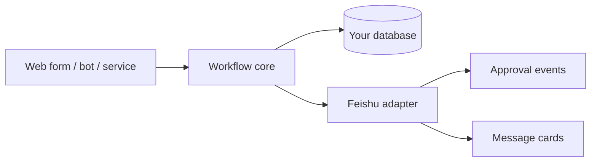

<div align="center">

# Feishu Admin Workflow Kit

**Composable administrative workflows with optional Feishu adapters and synthetic examples.**

[](https://github.com/changhaoting1998-star/feishu-admin-workflow-kit/actions/workflows/ci.yml)
[](https://nodejs.org/)
[](LICENSE)
[](docs/PRIVACY.md)

[Quick start](#quick-start) · [Modules](#included-modules) · [Feishu boundary](#feishu-boundary) · [中文说明](#中文说明)

</div>

Feishu Admin Workflow Kit is a small JavaScript foundation for visitor, meeting-room and maintenance workflows. It keeps reusable business transitions independent from Feishu so teams can test their rules locally, connect another platform later, or embed the modules in an existing service.

All included identities, requests, locations and messages are fictional. The repository contains no real approval record, employee, address, attachment, group history or Feishu credential.

## Why this project

- **Business rules stay portable.** The state machine works without an SDK or network connection.
- **Common admin flows are ready to extend.** Start from working visitor, room and maintenance modules.
- **Feishu is an adapter.** User mapping, event normalization and message cards live at the edge.
- **Safe to explore.** Mock mode, synthetic fixtures, CI and privacy scanning are included.
- **Easy to read.** The core has no framework or database dependency.

## Included modules

| Module | Included behavior |
| --- | --- |
| Generic workflow | Guarded transitions, actors, timestamps and immutable history |
| Visitor request | Submit, host confirmation, admin review and completion |
| Meeting room | Reservation creation and time-conflict detection |
| Maintenance | Register, assign, handle, accept and close |
| Feishu adapter | User mapping, event normalization and message-card construction |



## Quick start

```bash
git clone https://github.com/changhaoting1998-star/feishu-admin-workflow-kit.git
cd feishu-admin-workflow-kit
npm install
npm run verify
```

```js
import { createInstance, visitorWorkflow, act } from "feishu-admin-workflow-kit";

let request = createInstance(visitorWorkflow, {
  id: "demo_visitor_001",
  applicantId: "demo_user_a",
  purpose: "Demo meeting"
});

request = act(request, {
  type: "SUBMIT",
  actorId: "demo_user_a"
}, visitorWorkflow);
```

## Feishu boundary

Mock mode is the default and makes no external request. For a real integration, inject App Secret and tokens through the deployment environment and keep them out of Git. The recommended split is:

1. verify the inbound signature and event type at the HTTP edge;
2. translate Feishu identities and events into neutral domain actions;
3. run the workflow transition;
4. store the new state transactionally;
5. emit a Feishu message or approval update through an idempotent outbox.

See [docs/FEISHU.md](docs/FEISHU.md) for adapter notes.

## Production scope

This package supplies workflow building blocks. A production application must still implement authentication, RBAC, schema validation, transactional persistence, rate limits, audit retention, attachment controls and tenant isolation.

## Roadmap

- [ ] Persistent repository interface
- [ ] Idempotent event-outbox example
- [ ] Vehicle and procurement workflow examples
- [ ] Feishu approval-definition mapping
- [ ] TypeScript declarations
- [ ] Example REST service

## 中文说明

这是一个轻量的企业行政流程模块库，将访客、会议室、报修等通用业务规则与飞书接入分开。你可以先在本地验证流程，再按需连接飞书审批、机器人消息卡片或现有后台服务。

仓库仅使用虚构演示数据，不含真实员工、审批记录、地址、附件、群消息或凭证。真实接入前请阅读 [隐私说明](docs/PRIVACY.md)。

## Contributing

Focused workflow modules, tests and documentation improvements are welcome. Read [CONTRIBUTING.md](CONTRIBUTING.md) before opening a pull request and use [SECURITY.md](SECURITY.md) for vulnerability reports.

If the kit gives you a useful starting point, a star helps other Feishu builders discover it.

## License

[MIT](LICENSE). Feishu is a third-party product name; this project is not affiliated with or endorsed by Feishu.
